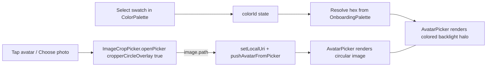

## 1. Add the circular-crop library

Add as runtime dep:

- `react-native-image-crop-picker` — provides `cropperCircleOverlay: true`, native UI on both platforms.
- `@config-plugins/react-native-image-crop-picker` — Expo community config plugin that wires up iOS Pods and Android Gradle/Manifest bits so `expo-dev-client` builds work without manual native edits.

Wire the plugin in [mobile/app.json](mobile/app.json) `plugins` (replace the current `expo-image-picker` plugin entry):

```json
[
  "@config-plugins/react-native-image-crop-picker",
  { "photosPermission": "The app accesses your photos to set your profile picture." }
]
```

Keep `NSPhotoLibraryUsageDescription` already present in [mobile/ios/waytwo/Info.plist](mobile/ios/waytwo/Info.plist). After installing, run `npx expo prebuild` (or `pod install` + Android sync) and a native rebuild via `npm run ios` / `npm run android`. The current native iOS project is checked in, so the user (or CI) needs to rebuild once.

`expo-image-picker` is only used in [mobile/src/app/(onboarding)/look.tsx](mobile/src/app/(onboarding)/look.tsx); after migration it can be removed from `package.json` and `app.json` to keep the native footprint small.

## 2. Replace the picker call in look.tsx

In [mobile/src/app/(onboarding)/look.tsx](mobile/src/app/(onboarding)/look.tsx), `pickImage()` becomes:

```ts
import ImageCropPicker from 'react-native-image-crop-picker';

const image = await ImageCropPicker.openPicker({
  width: 480,
  height: 480,
  cropping: true,
  cropperCircleOverlay: true,
  mediaType: 'photo',
  compressImageQuality: 0.85,
  cropperToolbarTitle: t('onboarding.look.cropTitle'),
  cropperChooseText: t('common.choose'),
  cropperCancelText: t('common.cancel'),
});
```

- Wrap in `try/catch`; the lib throws `E_PICKER_CANCELLED` when the user cancels — treat as a no-op like today.
- Drop the manual `requestMediaLibraryPermissionsAsync` step; the lib triggers the system prompt itself. Keep a `log.warn` on permission errors via the catch block.
- Add the new strings to [mobile/src/locales/en/common.json](mobile/src/locales/en/common.json) and [mobile/src/locales/uk/common.json](mobile/src/locales/uk/common.json) under `onboarding.look.cropTitle` and a shared `common.{choose,cancel}` group.
- After receiving `image.path`, pass it to `setLocalUri(image.path)` and `pushAvatarFromPicker(image.path)` as today.

## 3. Add a colored "backlight" around the avatar

The selected color (from `colorId` -> `OnboardingPalette` hex in [mobile/src/constants/theme.ts](mobile/src/constants/theme.ts)) drives a soft colored glow around the avatar circle, visible whether or not a photo is set.

Pure-RN, no extra deps: stack two absolutely-positioned circles behind the avatar inside [mobile/src/components/onboarding/avatar-picker.tsx](mobile/src/components/onboarding/avatar-picker.tsx):

```tsx
{glowColor ? (
  <>
    <View style={[styles.glowOuter, { backgroundColor: glowColor }]} />
    <View style={[styles.glowInner, { backgroundColor: glowColor }]} />
  </>
) : null}
<Pressable style={[styles.avatarFrame, { backgroundColor: c.surface, borderColor: c.inputBorder }]}>
  {showImage ? (...) : <Text style={styles.initials}>{letter}</Text>}
</Pressable>
```

Sizing/opacity (added as tokens in [mobile/src/constants/tokens.ts](mobile/src/constants/tokens.ts), all relative to `Size.onboardingAvatar = 120`):

- `glowOuter`: width/height = `Size.onboardingAvatar + 96`, `borderRadius = half`, `opacity ~= 0.18`.
- `glowInner`: width/height = `Size.onboardingAvatar + 40`, `opacity ~= 0.32`.
- Both absolutely positioned and centered on the avatar via `alignItems: 'center'` on a wrapper `View` (the existing `block` already centers content).
- iOS-only enhancement: also set `shadowColor: glowColor`, `shadowOpacity: 0.7`, `shadowRadius: 30` on the avatar frame for a more native glow; on Android `shadowColor` is honored from API 28+, so the same prop yields a softer bloom. This is a progressive enhancement, the layered circles already deliver the effect cross-platform.

API change for `<AvatarPicker>`:

- New prop: `glowColor?: string | null`.
- In [mobile/src/app/(onboarding)/look.tsx](mobile/src/app/(onboarding)/look.tsx), derive `glowColor` from `colorId` via a small lookup against `OnboardingPalette` and pass it through.
- When `colorId` is `null`, `glowColor` is `null` and the avatar renders exactly as today (no halo).

## 4. Cleanup

- Remove `expo-image-picker` from `mobile/package.json` dependencies and from `mobile/app.json` plugins after the new picker is wired up.
- Keep `NSPhotoLibraryUsageDescription` in [mobile/ios/waytwo/Info.plist](mobile/ios/waytwo/Info.plist).
- Run `npx tsc --noEmit` in `mobile/` and a clean native build (`npm run ios` / `npm run android`).

## Flow

