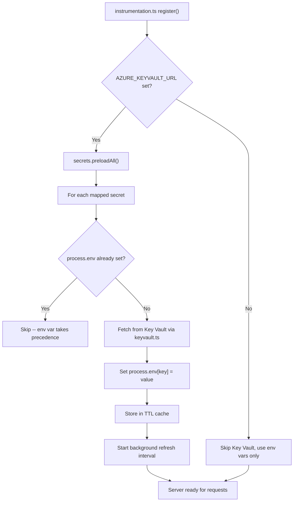

# Azure Key Vault Support for Backend

## Context

The backend ([`backend/api/`](backend/api/)) currently reads all secrets from `process.env` via `.env.local`. The goal is to add Azure Key Vault as an **optional** secondary secret source: env vars take precedence, Key Vault fills in missing values. Only sensitive secrets are loaded from Key Vault. Secrets are cached with a configurable TTL.

## Architecture



## Approach: Instrumentation-time preloading

Use Next.js `instrumentation.ts` `register()` to pre-warm secrets into `process.env` **before** the server handles any requests. This means existing code (`middleware.ts`, `supabase.ts`, `supabase-admin.ts`) continues reading `process.env` with zero changes to secret access patterns. A background `setInterval` refreshes the cache per the configured TTL.

## Secret mapping

A constant in `secrets.ts` defines which env vars can be sourced from Key Vault and their corresponding Key Vault secret names:

```typescript
const SECRET_MAP: Record<string, string> = {
  SUPABASE_SERVICE_ROLE_KEY: 'supabase-service-role-key',
  SUPABASE_PUBLISHABLE_KEY: 'supabase-publishable-key',
};
```

Key Vault secret names use lowercase-kebab-case (Azure convention). The map is code-defined (not env-configured) to keep the surface minimal and auditable.

## Files to create

### 1. [`backend/api/src/lib/keyvault.ts`](backend/api/src/lib/keyvault.ts) -- Key Vault client

- Wraps `@azure/keyvault-secrets` `SecretClient` with `DefaultAzureCredential`
- Instantiated lazily from `AZURE_KEYVAULT_URL`
- `getSecret(name: string): Promise<string | undefined>` -- fetches a single secret
- TTL-based in-memory cache (`Map<string, { value: string; fetchedAt: number }>`)
- Cache TTL configurable via `AZURE_KV_CACHE_TTL_MS` env var (default: 1 hour)
- On fetch failure: log warning, return cached value if available, return `undefined` if not

### 2. [`backend/api/src/lib/secrets.ts`](backend/api/src/lib/secrets.ts) -- Secret orchestration

- Exports `SECRET_MAP` constant (env var name -> Key Vault secret name)
- `preloadAll(): Promise<void>` -- iterates `SECRET_MAP`, for each key where `process.env[key]` is not set, fetches from Key Vault and sets `process.env[key]`
- `startRefreshLoop(): void` -- `setInterval` that re-fetches all mapped secrets and updates `process.env` (respects TTL; does not overwrite env vars that were set at process start)
- `stopRefreshLoop(): void` -- clears the interval (for testing/shutdown)
- `isKeyVaultEnabled(): boolean` -- checks if `AZURE_KEYVAULT_URL` is set

## Files to modify

### 3. [`backend/api/package.json`](backend/api/package.json) -- Dependencies

Add:
- `@azure/keyvault-secrets` (latest)
- `@azure/identity` (latest)

### 4. [`backend/api/instrumentation.ts`](backend/api/instrumentation.ts) -- Startup hook

In the existing `register()` function, after the logger setup, add:
```typescript
if (process.env.AZURE_KEYVAULT_URL) {
  const { preloadAll, startRefreshLoop } = await import('./src/lib/secrets');
  await preloadAll();
  startRefreshLoop();
}
```

### 5. [`backend/api/src/middleware.ts`](backend/api/src/middleware.ts) -- Move env reads into function

Move the module-scope `process.env` reads (lines 6-10) inside the `middleware()` function body. This ensures secrets populated by `instrumentation.ts` are picked up even if the module is loaded early. Minimal change -- just relocate the three `const` declarations.

### 6. [`backend/api/.env.local.example`](backend/api/.env.local.example) -- Document new vars

Add:
```
# Azure Key Vault (optional). If set, missing secrets are loaded from Key Vault.
# AZURE_KEYVAULT_URL=https://your-vault.vault.azure.net
# Cache TTL in milliseconds (default: 3600000 = 1 hour)
# AZURE_KV_CACHE_TTL_MS=3600000
```

### 7. [`architecture/adr/0005-azure-keyvault-secrets.md`](architecture/adr/0005-azure-keyvault-secrets.md) -- ADR

Document the decision: optional Key Vault with DefaultAzureCredential, env-var-first precedence, TTL caching, instrumentation-time preloading.

## Key design decisions

- **Env vars always win**: If `SUPABASE_SERVICE_ROLE_KEY` is set in `.env.local`, Key Vault is not consulted for that secret. This keeps local dev simple.
- **Graceful degradation**: If Key Vault is unreachable, the app logs a warning and continues with whatever env vars are available. No hard failure.
- **No changes to existing secret consumers**: By populating `process.env` at instrumentation time, `supabase.ts`, `supabase-admin.ts`, and `middleware.ts` continue working as-is (aside from the middleware module-scope fix).
- **DefaultAzureCredential**: Supports managed identity (Azure deployment), Azure CLI (local dev), environment variables, and more -- no custom auth code needed.
