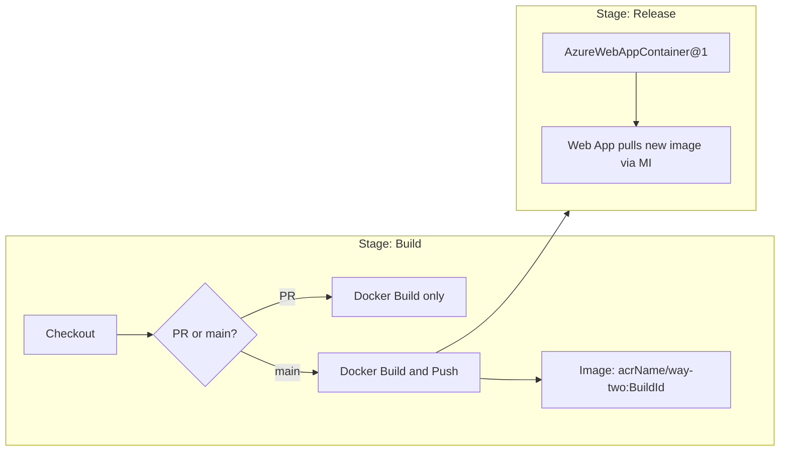

# Azure Pipeline for Backend CI/CD

## Context

The backend is a Next.js API app at `backend/api/` with an existing multi-stage [Dockerfile](backend/api/Dockerfile). No CI/CD pipeline exists yet. The pipeline will be triggered on both push and PR to `main`.

## Pipeline file

Create [`backend/azure-pipelines.yml`](backend/azure-pipelines.yml) with two stages.

### Trigger

```yaml
trigger:
  branches:
    include:
      - main
  paths:
    include:
      - backend/**

pr:
  branches:
    include:
      - main
  paths:
    include:
      - backend/**
```

Path-scoped to `backend/**` so mobile-only changes don't trigger builds.

### Variables (to be filled in by the team)

- `azureSubscription` -- Azure service connection name
- `acrName` -- ACR login server (e.g. `myregistry.azurecr.io`)
- `webAppName` -- Azure Web App name
- `resourceGroup` -- Azure resource group

### Stage 1: Build

- **On PR**: Docker build only (validate the image builds successfully, no push).
- **On main push**: Docker build **and push** to ACR.
- Use `Docker@2` task. The `command` switches between `build` (PR) and `buildAndPush` (main) based on a condition checking `Build.Reason` or `Build.SourceBranch`.
- Image: `way-two` (repository name in ACR).
- Tag: `$(Build.BuildId)` (the pipeline build number).
- Docker build context: `backend/api/` with the existing Dockerfile.

### Stage 2: Release

- Depends on Build stage.
- **Condition**: runs only when the source branch is `main` (skipped entirely on PRs).
- Uses `AzureWebAppContainer@1` task -- the native Azure DevOps task for deploying container images to Azure Web App for Containers.
- Inputs: `azureSubscription`, `appName`, `imageName` (`$(acrName)/way-two:$(Build.BuildId)`).
- The Web App is already configured to pull from ACR via managed identity, so no registry credentials are needed.

### Flow


