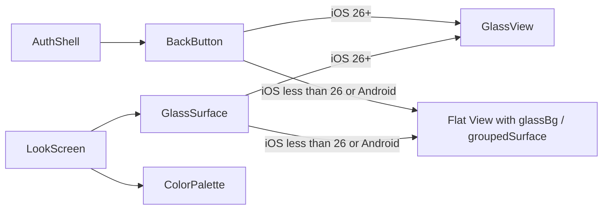

## Goal

Replace the inline back button in `AuthShell` and the flat `colorCard` wrapper in the onboarding "look" screen with real native Liquid Glass on iOS 26+, keeping the existing flat look as the fallback on all other platforms/versions. No new dependency — `expo-glass-effect` is already in [mobile/package.json](mobile/package.json) and Podfile.lock but not yet imported anywhere.

## Architecture

`GlassView` from `expo-glass-effect` already returns a regular `View` on unsupported platforms, but we gate explicitly on `isLiquidGlassAvailable()` so we can apply the existing semantic background/border tokens in the fallback branch (otherwise fallback is fully transparent).

## New reusable primitives

### 1) `mobile/src/components/ui/back-button.tsx` (new)

Reusable round-square back chevron button. Lifts the styling currently duplicated at [auth-shell.tsx](mobile/src/components/auth/auth-shell.tsx) L134-L145 and L183-L192 into its own component. The Liquid Glass effect is an internal implementation detail, not part of the public name. Props: `onPress`, optional `accessibilityLabel`, optional `style` for positioning overrides.

- Size: `Size.iconButton` (48)
- Radius: `BorderRadius.xl` (24)
- Icon: `Ionicons` `chevron-back`, `IconSize.lg`, color `c.text`
- iOS 26+: renders `<GlassView glassEffectStyle="regular" isInteractive style={...} />` as the background, with `Pressable` on top.
- Fallback: `Pressable` with `backgroundColor: c.glassBg`, `borderColor: c.glassBorder`, `borderWidth: Size.borderWidth` (exactly today's look).
- Pressed state: `opacity: Opacity.pressed` (match existing `pressed` style).

### 2) `mobile/src/components/ui/glass-surface.tsx` (new)

Thin presentational wrapper for grouped card surfaces.

- Props: `children`, `style?`, optional `glassStyle?: 'regular' | 'clear'` (default `'regular'`).
- iOS 26+: renders `GlassView` with `glassEffectStyle={glassStyle}` as the background layer, children on top inside a padded `View`.
- Fallback: a plain `View` with `backgroundColor: c.groupedSurface`, `borderColor: c.inputBorder`, `borderWidth: Size.borderWidth`.
- Radius is provided by the consumer via `style` (keeps `BorderRadius.onboardingColorCard` at the call site).

Both components read semantic colors via `useAuthColors()` (already used across auth/onboarding).

## Integrations

### `mobile/src/components/auth/auth-shell.tsx`

- Import and render `<BackButton onPress={onBack} />` in place of the inline `Pressable` + chevron (L133-L147).
- Remove `styles.back` and `styles.pressed` (now owned by the new primitive). Keep `marginBottom: Spacing.xl` by passing `style={{ marginBottom: Spacing.xl, alignSelf: 'flex-start' }}`.

### `mobile/src/app/(onboarding)/look.tsx`

- Replace the `View` with `styles.colorCard` around `ColorPalette` (L193-L206) with `<GlassSurface style={styles.colorCard}>…</GlassSurface>`.
- `colorCard` style keeps `borderRadius: BorderRadius.onboardingColorCard`, padding, and gap; the `backgroundColor` / `borderColor` / `borderWidth` fields move into `GlassSurface` fallback so the glass path is clean.

## Tokens

No new tokens required. `BorderRadius.xl`, `BorderRadius.onboardingColorCard`, `Size.iconButton`, `Size.borderWidth`, `Opacity.pressed`, and the `glassBg` / `glassBorder` / `groupedSurface` / `inputBorder` semantic colors in [mobile/src/constants/theme.ts](mobile/src/constants/theme.ts) are already sufficient.

## Platform / availability

- `isLiquidGlassAvailable()` from `expo-glass-effect` is the single gate inside each primitive. No `Platform.OS` checks needed (the helper already validates compiler, OS, and Info.plist).
- Android and iOS < 26 continue to see the exact current look — zero visual regression.
- New Arch (already enabled in [mobile/app.json](mobile/app.json)) is compatible with `expo-glass-effect`.

## Logging, i18n, accessibility

- No new user-facing copy; i18n untouched.
- `BackButton` exposes `accessibilityRole="button"` and uses `t('common.back')` as default `accessibilityLabel` (falls back to `'Back'` if the key is missing — consumers can override). Verify the key exists in [mobile/src/locales/en/common.json](mobile/src/locales/en/common.json) and [mobile/src/locales/uk/common.json](mobile/src/locales/uk/common.json); add if missing.
- No new logs — purely presentational change.

## Verification

- `expo-doctor` / TypeScript: `cd mobile && pnpm tsc --noEmit` (or the project's existing type-check script).
- Run the app on an iOS 26 simulator (Xcode 26+) to confirm glass renders on the back button and color card.
- Run on an iOS 18 simulator to confirm the fallback matches current visuals.
- Run on Android to confirm no regression (falls back to flat).