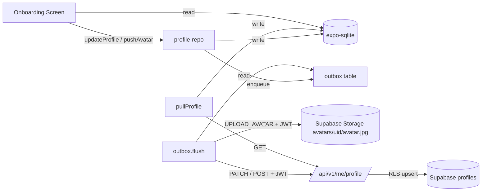

# Onboarding + Local-First Data Layer

## 1. Update requirements doc

Rewrite [requirements/onboarding.md](requirements/onboarding.md) so it matches the final scope:

- Remove fields **#4 Partner's name** and **#5 When you met** — these move to the future pair-creation flow.
- Add rules:
  - Back button is shown on every onboarding step.
  - Back on step 1 opens a system Alert asking "Log out?"; confirming signs the user out and returns to `(auth)`.
  - Skip is only available on the avatar/color step and routes directly to Home.
  - Onboarding resumes from the last saved step on app relaunch.
  - After completion or skip the user lands on Home (`(tabs)`); invite/pair flow is deferred.
- Final step list:
  1. Intro (no inputs)
  2. Your info — name (required), gender (required), date of birth (optional)
  3. Avatar + profile color (both optional; screen also exposes Skip)

## 2. Backend: Supabase schema + API

### 2.1 New table `public.profiles`

Add migration `backend/api/supabase/migrations/0001_profiles.sql`:

```sql
create table public.profiles (
  user_id uuid primary key references auth.users(id) on delete cascade,
  display_name text,
  gender text check (gender in ('male','female','other')),
  date_of_birth date,
  photo_path text,
  color_id text,
  onboarding_step smallint not null default 0,
  onboarding_completed_at timestamptz,
  created_at timestamptz not null default now(),
  updated_at timestamptz not null default now()
);
alter table public.profiles enable row level security;
create policy profiles_self_select on public.profiles for select using (auth.uid() = user_id);
create policy profiles_self_upsert on public.profiles for insert with check (auth.uid() = user_id);
create policy profiles_self_update on public.profiles for update using (auth.uid() = user_id);
```

Create Storage bucket `avatars` as **public-read** (so avatar URLs can be used directly in `<Image>` without signing on every render). RLS on `storage.objects` restricts writes/deletes to the owner:

```sql
-- public read
create policy avatars_public_read on storage.objects
  for select using (bucket_id = 'avatars');
-- owner-only write/update/delete, path layout: avatars/{user_id}/avatar.jpg
create policy avatars_owner_write on storage.objects
  for insert with check (bucket_id = 'avatars' and auth.uid()::text = (storage.foldername(name))[1]);
create policy avatars_owner_update on storage.objects
  for update using (bucket_id = 'avatars' and auth.uid()::text = (storage.foldername(name))[1]);
create policy avatars_owner_delete on storage.objects
  for delete using (bucket_id = 'avatars' and auth.uid()::text = (storage.foldername(name))[1]);
```

### 2.2 API routes

New files under [backend/api/src/app/api/v1/me/](backend/api/src/app/api/v1/me/):

- `profile/route.ts` — `GET` returns full profile row (creates a blank one if missing); `PATCH` accepts a Zod-validated partial `{ display_name?, gender?, date_of_birth?, color_id?, photo_path?, onboarding_step? }` and upserts. Uses a per-request Supabase client bound to the caller's JWT so RLS applies. `photo_path` is validated against the stable shape `avatars/{user_id}/avatar.jpg` and must match the caller's `user_id`.
- `profile/complete/route.ts` — `POST` sets `onboarding_completed_at = now()`.

**No backend avatar endpoint.** The mobile client uploads bytes directly to Supabase Storage via the user's JWT + RLS, then `PATCH /me/profile` to commit `photo_path`. Settings will reuse the same pair of operations.

Add helper [backend/api/src/lib/supabase-user.ts](backend/api/src/lib/supabase-user.ts) that creates a `@supabase/supabase-js` client using the bearer token from the request (parallels [backend/api/src/lib/supabase-admin.ts](backend/api/src/lib/supabase-admin.ts)).

Document routes with Swagger comments like [backend/api/src/app/api/v1/me/route.ts](backend/api/src/app/api/v1/me/route.ts).

### 2.3 Avatar storage contract (Option A — stable path)

- **Path:** `avatars/{user_id}/avatar.jpg` (always). New uploads overwrite old bytes via `upsert: true`, so no orphan cleanup is needed.
- **URL rendering:** public URL built as `${SUPABASE_URL}/storage/v1/object/public/avatars/{user_id}/avatar.jpg?v={profiles.updated_at epoch}` so cached images invalidate whenever the row is patched.
- **`photo_path`** is stored as the relative path (not the full URL) so we can rebuild it with any cache-bust suffix at read time.

## 3. Mobile: local-first data layer (expo-sqlite)

Add dependency `expo-sqlite` and `@react-native-community/netinfo`.

New module `mobile/src/lib/db/`:

- `schema.ts` — SQL for three tables on first open:
  - `profile` (single row; mirrors server columns + `photo_local_uri TEXT NULL`, `photo_pending INTEGER NOT NULL DEFAULT 0`, `dirty INTEGER NOT NULL DEFAULT 0`, `last_synced_at TEXT`)
  - `outbox` (`id`, `op`, `entity_id`, `payload_json`, `created_at`, `attempts`, `last_error_at`, `last_error_message`); unique index on `(op, entity_id)` where status is pending so a second write to the same entity supersedes the first.
  - `meta` (key/value — e.g. `profile_pulled_at`, `schema_version`)
- `client.ts` — opens `waytwo-<user_id>.db` via `expo-sqlite`; migrations keyed by `meta.schema_version`; `closeAndWipe()` for logout (also clears any `photo_local_uri` file it owns in the app cache dir).
- `profile-repo.ts` — typed `getProfile()`, `upsertProfile(partial)`, `setOnboardingStep(n)`, `markOnboardingComplete()`, `setLocalAvatar(fileUri)`. All writes set `dirty = 1`.

New module `mobile/src/lib/sync/`:

- `outbox.ts` — `enqueue(op)`, `flush()` with exponential backoff, single-flight guard, reads bearer from `supabase.auth.getSession()`. Supported ops: `PATCH_PROFILE`, `COMPLETE_ONBOARDING`, `UPLOAD_AVATAR`.
- `profile-sync.ts`:
  - `pullProfile()` — GET /me/profile → write local, clear `dirty`. If remote `photo_path` matches a still-pending local upload, clear `photo_pending` and the cached `photo_local_uri`.
  - `pushProfileUpdate(partial)` — write local + enqueue `PATCH_PROFILE`.
  - `pushCompleteOnboarding()` — write local + enqueue `COMPLETE_ONBOARDING`.
  - `pushAvatar(localUri)` — copy file into app cache, set `photo_local_uri` + `photo_pending=1` locally, then enqueue `UPLOAD_AVATAR`. The flusher, on success, enqueues a follow-up `PATCH_PROFILE { photo_path: 'avatars/{uid}/avatar.jpg' }` so the DB commit happens only after the bytes land.
- Avatar upload implementation: `supabase.storage.from('avatars').upload('{uid}/avatar.jpg', blob, { upsert: true, contentType: 'image/jpeg' })` using the user's session — RLS handles authorization. Stable path means no cleanup; cache-busting via `?v={updated_at}` at read time.
- Flush triggers: on app foreground (`AppState`), on network regained (`NetInfo.addEventListener`), and immediately after each enqueue.

New provider [mobile/src/context/ProfileContext.tsx](mobile/src/context/ProfileContext.tsx): mounts inside `AuthProvider` once a session exists; on mount runs `pullProfile()` (best-effort), then exposes `{ profile, loading, setStep, updateProfile, completeOnboarding }` backed by the repo + sync module. On `supabase.auth.signOut()` it calls `closeAndWipe()`.

All logging through `mobile/src/lib/log` (no PII / photo URLs / emails).

## 4. Mobile: onboarding screens

New route group `mobile/src/app/(onboarding)/`:

- `_layout.tsx` — `Stack` with `headerShown: false`; exports an `ErrorBoundary`.
- `intro.tsx` — Figma node `326:5995`. Hero copy + single "Continue" button.
- `you.tsx` — Figma nodes `326:6003/6015/6027` (three data states of the same 3-input screen). Fields: display name (required, inline validation), gender segmented control (male/female/other), date of birth (optional, opens native picker).
- `look.tsx` — Figma nodes `326:6039/6080`. Avatar picker with initials fallback; on image pick calls `pushAvatar(localUri)` so the UI shows the local file instantly while the outbox uploads to Supabase Storage and then patches `photo_path`. 12-color palette; bottom CTA "Finish"; secondary "Skip" link. Uses `expo-image-picker`.

Shared components under `mobile/src/components/onboarding/`:

- `onboarding-shell.tsx` — mirrors [mobile/src/components/auth/auth-shell.tsx](mobile/src/components/auth/auth-shell.tsx). Always renders back button. Accepts `onBack?: () => void`; default behaviour is `router.back()`. On the intro screen the handler shows `Alert.alert(t('onboarding.logoutTitle'), t('onboarding.logoutMessage'), [cancel, confirm→signOut])`.
- `gender-segmented.tsx`, `date-field.tsx`, `avatar-picker.tsx`, `color-palette.tsx`.

Each "Continue" tap calls `updateProfile({...fields, onboarding_step: nextStep})` first, then navigates — so a crash/kill mid-flow still resumes at the right place. `completeOnboarding()` on Finish/Skip then `router.replace('/(tabs)')`.

## 5. Navigation guard

Extend [mobile/src/app/_layout.tsx](mobile/src/app/_layout.tsx) `NavigationRoot`:

```tsx
if (session && profile && !profile.onboardingCompletedAt) {
  const target = ONBOARDING_ROUTES[profile.onboardingStep] ?? '/(onboarding)/intro';
  if (root !== '(onboarding)') router.replace(target);
  return;
}
if (session && profile?.onboardingCompletedAt && root === '(onboarding)') {
  router.replace('/(tabs)');
}
```

Wrap tree as `I18nextProvider → AuthProvider → ProfileProvider → NavigationRoot`. Render `null` until `initialized && profileLoaded`.

## 6. Design tokens + i18n

- Add palette to [mobile/src/constants/theme.ts](mobile/src/constants/theme.ts): `OnboardingPalette: Array<{ id: string; hex: string }>` with 12 entries. Extract hex values via `get_variable_defs` on Figma frame `326:6051` during implementation; mark `FIGMA_GAP` if the file uses raw hex.
- Add `AuthFlowGradients.onboarding` (or similar) and surface it via `OnboardingShell`.
- Add i18n keys to both [mobile/locales/en/common.json](mobile/locales/en/common.json) and [mobile/locales/uk/common.json](mobile/locales/uk/common.json) under `onboarding.*`: `intro.title`, `intro.subtitle`, `intro.cta`, `you.title`, `you.nameLabel`, `you.genderLabel`, `you.genderMale/Female/Other`, `you.dobLabel`, `look.title`, `look.colorLabel`, `look.skip`, `look.finish`, `common.continue`, `common.back`, `logoutTitle`, `logoutMessage`, `logoutConfirm`, `errors.syncFailed`.

## 7. Architecture docs

- New ADR [architecture/adr/0006-local-first-data-with-expo-sqlite.md](architecture/adr/0006-local-first-data-with-expo-sqlite.md): records the choice of `expo-sqlite` + write-outbox over WatermelonDB/AsyncStorage, with rationale and consequences.
- New feature doc `architecture/features/onboarding.md` mirroring [architecture/features/authentication.md](architecture/features/authentication.md): covers mobile screens, sync flow, API contract, and step-resume logic.

## Data flow



## Observability / logging

Every main step in the onboarding + sync path emits a structured log so issues are debuggable from device logs and server output alone.

**Mobile** (through `mobile/src/lib/log`, no PII / tokens / photo URIs):

- `log.info` at action boundaries the user triggered: onboarding screen mount, Continue pressed, Skip pressed, back-to-logout confirmed, avatar picked, step persisted, onboarding completed. Include `{ step, hasPhoto, colorId }` — never the actual name, DOB, or file URI.
- `log.debug` for internal transitions: outbox enqueue (`{ op, entityId, attempts }`), flush start/finish (`{ pending, succeeded, failed }`), sync pull result (`{ pulledAt, step }`), SQLite migration runs, avatar local-file copy.
- `log.warn` on recoverable failures: upload retry, PATCH retry, pull failure (offline). Include `{ op, status, attempts, message }`.
- `log.error` for non-retryable failures that surface to the user: DB open/migration failure, unexpected sync error, logout-confirm errors.

**Backend** (through `backend/api/src/lib/logger`):

- `logger.info` at route entry with `{ route, method, userId }` and at route exit with `{ route, status, durationMs }` for every new `/api/v1/me/profile*` endpoint.
- `logger.info` for main DB steps: "profile upserted", "onboarding completed", with `{ userId, fieldsChanged: ['display_name','gender',...], step }`. Never log raw field values.
- `logger.warn` on validation failures (`{ route, issues }` from Zod), RLS denials (`{ route, code }`), or Supabase errors (`{ route, message, code, status }`).
- `logger.error` only for truly unexpected conditions (5xx), already wrapped by `toErrorResponse`.

This instrumentation is a cross-cutting requirement — new `.cursor/rules` entries below make it the default for future work.

## Agent rules updates

- Append to [.cursor/rules/frontend/frontend-dev.mdc](.cursor/rules/frontend/frontend-dev.mdc) a new rule:
  > "Instrument every user-facing action and background sync step: `log.info` at the action boundary (what the user did / what the system decided), `log.debug` for intermediate transitions (queue enqueue, DB writes, flush results), `log.warn` for retryable failures, `log.error` for surface-level failures. Logs must carry structured metadata (`op`, `step`, `status`, `attempts`, `durationMs`, counts) but never user-entered text, file URIs, tokens, or URLs that contain them."
- Append to [.cursor/rules/backend/architecture.mdc](.cursor/rules/backend/architecture.mdc) under a new `## Observability` section:
  > "Every route handler under `/api/v1/*` logs `info` on entry (`{ route, method, userId }`) and on exit (`{ route, status, durationMs }`). Main domain steps (DB upserts, state transitions, external calls) emit `info` with the operation name and non-sensitive metadata (changed field names, counts, ids — never values). `warn` for validation / RLS / Supabase errors with `{ message, code, status }`. `error` is reserved for unexpected 5xx paths via `toErrorResponse`."
- No change to [.cursor/rules/common.mdc](.cursor/rules/common.mdc) or [.cursor/rules/frontend/i18n.mdc](.cursor/rules/frontend/i18n.mdc).

## Transactional safety notes

- **Ordering:** UI writes to SQLite first, outbox pushes second. The user always sees what they entered even if the device is offline.
- **Avatar two-step:** `UPLOAD_AVATAR` must succeed before `PATCH_PROFILE { photo_path }` is enqueued, so `profiles.photo_path` never points to a missing object.
- **Idempotency:** stable storage path means retries are overwrites; PATCH with the same body is a no-op; outbox dedupe by `(op, entity_id)` collapses rapid repeat edits.
- **Orphans:** Option A (stable path) leaves no orphans — every upload overwrites the previous object. No sweeper needed.
- **Cache busting:** clients render avatar URL with `?v={profiles.updated_at epoch}`; changing the row invalidates caches globally.
- **Logout:** `closeAndWipe()` removes the per-user SQLite DB and any `photo_local_uri` cached file.
