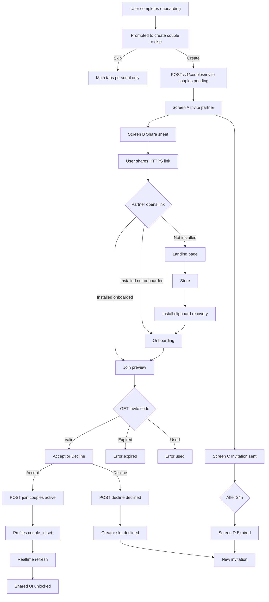

# Feature: Pair Creation

## Goal

Allow a user to create a couple inside the application and securely link with their partner using a unique invite code embedded in a shareable HTTPS link. That establishes the shared space where couple-based features (Moments, Heartbeat, Countdown, Main Note, Colors, and similar) operate.

The app must still let the user reach the main screen and use personal features before a partner is linked.

## Description

Pair creation is the process where two individual users merge into a shared couple profile. The invite is **link only** (no manual code entry in the app). The partner opens the link; unauthenticated or new users complete install, registration, and onboarding, then accept the invite with the code preserved via a deferred mechanism (see [Invite link format](#invite-link-format)).

## Confirmed decisions

- Invite mechanism: **link only** — no manual code entry UI.
- Unauthenticated partner: App Store / Google Play → install → register/onboard → **auto-join** with invite `code` recovered after install.
- **Deferred mechanism**: **clipboard fallback** — the landing page copies `code` to the clipboard before redirecting to the store; on first launch the app reads the clipboard to recover the code (subject to platform clipboard rules and user consent).
- **Cancel invite**: in scope — the creator can cancel a pending invite (see [Cancel invite](#cancel-invite)).
- **Invite landing page**: a single `GET /invite/[code]` route on the existing deployed Next.js app ([`backend/api`](../backend/api)) — no separate marketing site required.

## Invite link format

- Shared URL pattern: `https://<public-api-host>/invite/{code}` (replace `<public-api-host>` with the deployed domain).
- The page **server-renders Open Graph** meta tags (`og:title`, `og:description`, `og:image`) so messengers show an app preview card.
- **Redirect behavior**:
  - Attempt to open the app via custom scheme `waytwo://invite/{code}` when the app is installed.
  - If the app is not installed, redirect to the **App Store** (iOS) or **Google Play** (Android).
- **Clipboard**: before store redirect, client-side script copies `{code}` to the clipboard so the partner app can recover it on first launch after install.
- **Custom scheme alone** (`waytwo://…`) does **not** produce messenger link previews; the HTTPS landing page is required for previews and for store fallback.

## Flow overview

```
Partner opens link
  ├─ App installed + onboarded → Open app → join preview (creator details, accept / decline)
  ├─ App installed + NOT onboarded → Open app → complete onboarding → join preview
  ├─ App NOT installed (iOS) → Landing page → App Store → install → first launch reads clipboard → register/onboard → join preview
  └─ App NOT installed (Android) → Landing page → Google Play → same as iOS path
```

**Creator flow (high level)**

1. User completes onboarding.
2. User is prompted to create a couple or skip.
3. If create: backend creates a `pending` couple and a `pending` invite code; user receives HTTPS link.
4. User shares the link (system share sheet).
5. Partner follows branches above.
6. On accept: couple becomes `active`; both profiles reference the same `couple_id`; shared UI unlocks.

## Core requirements

- Invite `code` is generated on the **backend**, URL-safe, unguessable, and embedded in the HTTPS invite link.
- The invite must **expire** after a fixed period (**24 hours** from creation).
- If expired, the creator can **generate a new invite**; any previous `pending` code for that user is marked `expired` (only one active pending code per creator at a time).
- **Cancel invite**: the creator can cancel a pending invite from the home partner slot (confirmation alert). Cancelled codes are marked `cancelled`; the `pending` couple row is removed if there are no accepted members yet (see [Data model](#data-model)).
- **Pairing is symmetric**: neither partner is an “owner”; both are equal.
- After pairing, **shared features unlock** according to [Navigation after pairing](#navigation-after-pairing).
- **New / unregistered partners**: landing page → store → install → onboarding path must preserve `code` (clipboard + in-app handling). If the partner has the app but has not finished onboarding, they complete onboarding before the join step.

## Data model

### `couples`

| Column | Type | Notes |
|--------|------|--------|
| `id` | uuid PK | |
| `status` | text | `pending` — record exists, second member not yet accepted; `active` — both members joined |
| `created_at` | timestamptz | |
| `updated_at` | timestamptz | |

### `couple_members`

| Column | Type | Notes |
|--------|------|--------|
| `couple_id` | uuid FK → `couples.id` | |
| `user_id` | uuid FK → `auth.users.id` | **Unique** per user (at most one active couple membership per user) |
| `joined_at` | timestamptz | |

### `invite_codes`

| Column | Type | Notes |
|--------|------|--------|
| `code` | text PK | URL-safe random string (e.g. 12 characters) |
| `created_by` | uuid FK → `auth.users.id` | |
| `couple_id` | uuid FK → `couples.id` | |
| `expires_at` | timestamptz | Typically `created_at` + 24 h |
| `accepted_by` | uuid FK → `auth.users.id` nullable | Set when partner accepts |
| `status` | text | `pending` \| `accepted` \| `expired` \| `declined` \| `cancelled` |

### `profiles` extension

- Add nullable `couple_id` uuid FK → `couples.id` so the client can read couple membership from the profile row.

### RLS (summary)

- `invite_codes`: readable for preview by anyone who knows `code` (public preview endpoint uses service role or carefully scoped policy); mutations only by creator or system flows (join/decline/cancel).
- `couple_members`: members can read rows for their couple.
- Enforce business rules in API (e.g. cannot join own invite, one couple per user).

## API endpoints

REST routes under the existing API version prefix (e.g. `/api/v1/...` — follow current backend conventions).

| Method | Path | Auth | Purpose |
|--------|------|------|---------|
| `POST` | `/v1/couples/invite` | Yes | Creates `pending` couple + `pending` invite; marks prior `pending` codes for this user `expired`; returns `{ code, link, expires_at }` |
| `GET` | `/v1/couples/invite/{code}` | No (public) | Preview: `{ creator_display_name, creator_photo_path, expires_at, status }` |
| `POST` | `/v1/couples/join/{code}` | Yes | Validates `pending` and not expired; adds partner to `couple_members`; sets couple `active`; sets `accepted_by`; marks code `accepted`; updates both profiles’ `couple_id` |
| `POST` | `/v1/couples/invite/{code}/decline` | Yes (partner) | Marks code `declined`; creator UI updates via Realtime |
| `DELETE` | `/v1/couples/invite/{code}` | Yes (creator) | Cancels pending invite; marks code `cancelled`; deletes `pending` couple if no accepted members |

### Landing page (Next.js App Router, not JSON API)

- `GET /invite/[code]` — server-rendered HTML with OG tags; client script copies `code` to clipboard; redirects to `waytwo://invite/{code}` or to the correct store listing.

## Error states

| Condition | Audience | Behavior |
|-----------|----------|----------|
| Code expired | Partner | Message: invite expired; ask partner for a new link |
| Code declined | Creator (home slot) | “Invitation declined” + prompt to send a new invitation (Figma `151:3271`) |
| Code already used (`accepted`) | Partner | Message: invite already used |
| Code cancelled | Partner | Treat as invalid / expired for join flow |
| Inviting yourself | System | Reject server-side (`created_by` ≠ joining user) |
| User already in a couple | Partner | Message: already in a couple |
| Network failure | Both | Retryable error with “Try again” |

## Code regeneration

Generating a new invite marks all previous **`pending`** invite codes for that user as **`expired`**. At most one **`pending`** invite exists per creator at a time.

## Cancel invite

- Creator cancels from the **home screen partner slot** while status is pending; show a confirmation alert (copy per i18n; align with Figma edge cases in section `151:3270`).
- `DELETE /v1/couples/invite/{code}` sets invite `cancelled` and removes the `pending` couple row when there are no accepted members.
- UI returns to the **no-invite** partner slot (“Invite partner”).

## Notifications

Push notifications for pair events are **required in a future sprint** (infrastructure not in place yet).

When implemented, at minimum:

- Partner **accepted** → notify creator: couple is ready.
- Partner **declined** → notify creator.

**Interim:** the app subscribes to **Supabase Realtime** on `invite_codes` and/or `couple_members` (and refreshes profile) so the home partner slot updates without manual refresh.

## Navigation after pairing

- `profiles.couple_id` is non-null for both users.
- `ProfileProvider` (or a dedicated `CoupleProvider`) reacts to `couple_id` and drives UI state.
- Tab navigator: define which routes are **personal-only** (always visible) vs **couple-only** (visible when `couple_id` is set). Product must list concrete tab names when Moments / Heartbeat / etc. are implemented; until then, Home reflects paired state (dual avatars per Figma `310:4432`).

## Out of scope

- **Dissolution / unpairing** — not part of this version.
- **Push delivery** — deferred; see [Notifications](#notifications).

## Screens (Figma)

Copy in production must use **English** in `react-i18next`; Figma may show Ukrainian — treat as reference only.

### Creator — pairing flow

**A — Invite your partner** (`pairing -- 01` / `pairing -- 5`)

- Dark: [node `150:3058`](https://www.figma.com/design/NIofouu7Ph9yhZs118YH9j/WayTwo--Copy-?node-id=150-3058)
- Light: [node `349:8370`](https://www.figma.com/design/NIofouu7Ph9yhZs118YH9j/WayTwo--Copy-?node-id=349-8370)
- Headline: invite your other half; body explains shared features; primary CTA opens share; back (Liquid Glass) top-left.

**B — Share sheet** (`pairing -- 2` / `pairing -- 7`)

- Dark: [`150:3907`](https://www.figma.com/design/NIofouu7Ph9yhZs118YH9j/WayTwo--Copy-?node-id=150-3907)
- Light: [`349:8390`](https://www.figma.com/design/NIofouu7Ph9yhZs118YH9j/WayTwo--Copy-?node-id=349-8390)
- Same as A with iOS Activity View open.

**C — Invitation sent / pending** (`pairing -- 3` / `pairing -- 6`)

- Dark: [`150:5014`](https://www.figma.com/design/NIofouu7Ph9yhZs118YH9j/WayTwo--Copy-?node-id=150-5014)
- Light: [`349:8378`](https://www.figma.com/design/NIofouu7Ph9yhZs118YH9j/WayTwo--Copy-?node-id=349-8378)
- Headline: invitation sent; body: waiting for partner; link valid 24 hours; secondary share; text action to cancel (maps to [Cancel invite](#cancel-invite)).

**D — Invitation expired** (`pairing -- 4` / `pairing -- 8`)

- Dark: [`151:2516`](https://www.figma.com/design/NIofouu7Ph9yhZs118YH9j/WayTwo--Copy-?node-id=151-2516)
- Light: [`349:8404`](https://www.figma.com/design/NIofouu7Ph9yhZs118YH9j/WayTwo--Copy-?node-id=349-8404)
- Explains expiry; CTA to send a new invitation.

### Creator — home partner slot

| State | Primary label | Sub-label | Figma (examples) |
|-------|---------------|-----------|------------------|
| No invite | Invite partner | — | Light `349:8430`, Dark `150:2960` |
| Pending | Invitation sent | Link valid 24 hours | Light `349:8444`, Dark `150:4963` |
| Expired | Invitation time expired | Send new invitation | Light `349:8444`, Dark `151:2554` |
| Declined | Invitation declined | Send new invitation | Dark `151:3271` (edge cases) |
| Active | Partner avatar + name | — | Dark `310:4432` (edge cases) |

Implement **light and dark** for all states per Figma sections `home @light` / `home @dark` and `pairing @light` / `pairing @dark`.

### Partner

**E — Invited to join (cold start, not registered)**

- [`310:4352`](https://www.figma.com/design/NIofouu7Ph9yhZs118YH9j/WayTwo--Copy-?node-id=310-4352)
- Headline: invited to join; body: continue registration to accept; primary continues into onboarding while preserving `code`.

**Join preview (authenticated, onboarded)**

- Full-screen (or modal) showing creator preview from `GET /v1/couples/invite/{code}` with **Accept** and **Decline** actions. Dedicated Figma frame not listed in canonical nodes below — align tokens with pairing screens; add `FIGMA_GAP` in [`mobile/src/constants/tokens.ts`](../mobile/src/constants/tokens.ts) if a frame is assigned later.

### Edge-case alerts

- Section [`151:3270`](https://www.figma.com/design/NIofouu7Ph9yhZs118YH9j/WayTwo--Copy-?node-id=151-3270) — confirmation dialogs (e.g. cancel pending invite). Final strings via i18n.

## Design references (Figma)

File: [WayTwo (Copy)](https://www.figma.com/design/NIofouu7Ph9yhZs118YH9j/WayTwo--Copy-) — `fileKey` `NIofouu7Ph9yhZs118YH9j`.

| Section / frame | Node ID | URL |
|-----------------|---------|-----|
| home @light | `349:8413` | [link](https://www.figma.com/design/NIofouu7Ph9yhZs118YH9j/WayTwo--Copy-?node-id=349-8413) |
| pairing @light | `349:8369` | [link](https://www.figma.com/design/NIofouu7Ph9yhZs118YH9j/WayTwo--Copy-?node-id=349-8369) |
| home @dark | `150:4831` | [link](https://www.figma.com/design/NIofouu7Ph9yhZs118YH9j/WayTwo--Copy-?node-id=150-4831) |
| pairing @dark | `150:4824` | [link](https://www.figma.com/design/NIofouu7Ph9yhZs118YH9j/WayTwo--Copy-?node-id=150-4824) |
| home @dark (pending / expired variants) | `150:4962` | [link](https://www.figma.com/design/NIofouu7Ph9yhZs118YH9j/WayTwo--Copy-?node-id=150-4962) |
| pairing @dark (expired single) | `151:2608` | [link](https://www.figma.com/design/NIofouu7Ph9yhZs118YH9j/WayTwo--Copy-?node-id=151-2608) |
| edge cases @dark | `151:3270` | [link](https://www.figma.com/design/NIofouu7Ph9yhZs118YH9j/WayTwo--Copy-?node-id=151-3270) |
| home @light (variants) | `349:8429` | [link](https://www.figma.com/design/NIofouu7Ph9yhZs118YH9j/WayTwo--Copy-?node-id=349-8429) |
| pairing @light (expired) | `349:8403` | [link](https://www.figma.com/design/NIofouu7Ph9yhZs118YH9j/WayTwo--Copy-?node-id=349-8403) |

## Flow diagram



## Benefits

- Simple, intuitive linking for partners who are less comfortable with technology.
- Invite links avoid requiring phone number, email, or social login for the partner, which improves privacy and comfort.
- Asynchronous onboarding: one partner can start earlier; the other joins later.
- Couples can use shared emotional features as soon as they are paired.
- Less friction for long-distance couples (different time zones, devices).

## Author

Ivan Kulaha
